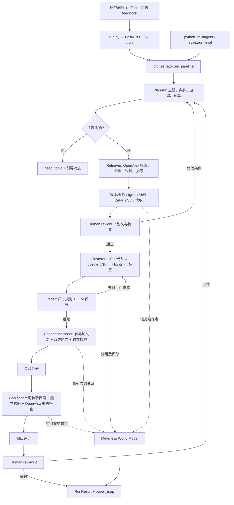

# 项目流程与文件分析

> **2026-10-26 状态更新**：下方“当前实现状态”表已按最新代码更新；“本次选择及理由”“本次实测结果”两节是首次实现聚类时的历史记录（当时 Connection/Gap 尚未实现、测试 159 项），保留作对照。

后续相似度优化已切换到 SemCSE cosine + complete linkage，旧连通分量仅保留作基线。
最新算法取舍、实验和新增文件入口见 [相似度优化报告](similarity-optimization.md)；下文 MiniLM 阈值实测是首次实现的历史基线。

本次按源码、文档、提示词、测试、样本和部署配置梳理。`.venv/`、`.git/`、字节码和缓存属于依赖或生成内容，不作为项目源码逐项分析；`.env` 只核对配置是否存在，不记录密钥。文件清单见末尾。

## 整体 flow



API 用 `RequestReviewer`：不等待键盘，feedback 只触发一次重新规划，其后自动批准。CLI 默认使用交互审核；`--auto-approve` 可跳过。World Model 是本项目对 Meterless 规格的 Python 实现，保存每次尝试的实体、边、证据和评分，不依赖单独启动一个 Meterless 图谱服务。

## 当前实现状态

| 层 / 阶段 | 入口文件 | 当前行为与限制 |
| --- | --- | --- |
| API / CLI | `run.py`, `litagent/api.py`, `litagent/map_routes.py`, `litagent/__main__.py` | `/run`、`/search`（网页人工审核 1）、`/cluster/*`（地图、移动、版本、分析、人工/AI 评审）、`/world/{run_id}`、`/maps`；结构化错误与输入验证 |
| 调度 | `litagent/orchestrator.py` | 五阶段、两次人审、三次评分、有限重试；超时/预算用尽返回 partial |
| 规划 | `agents/planner.py` | 真实 LLM + Pydantic；默认条件集中应用；重规划保留用户已给条件 |
| 检索 | `agents/retriever.py`, `tools/openalex.py` | OpenAlex 已实现；去重、无摘要过滤、70% 相关性/30% 年均引用、摘要回退 |
| 原始论文存储 | `integrations/zetaris.py` | 应用写 Postgres，Zetaris 读 `litagent_db.papers`；故障时内存回退并警告 |
| 聚类 | `agents/clusterer.py`, `question_clusters.py`, `cluster_labels.py`, `similarity.py` | SemCSE CPU 嵌入 + complete linkage 0.7；问题模式先选经原文核验的 main 池，其余分 side 主题；相邻组对照命名、片段引用 |
| 评分 | `agents/grader.py`, `agents/review_agent.py` | 三阶段 rubric 已完成；不看生产者理由；空输出按“弃权是否合理”评分；逐条 Review Agent 带解释归属审计 |
| 关联发现 | `agents/connection_finder.py`, `finding_engine.py` | 已实现：有界候选、双方原文片段、独立核验、任务缓存 |
| 缺口分析 | `agents/gap_finder.py` | 已实现：组内 + main–side 假设、独立核验、OpenAlex 覆盖检查；拒绝原文未说明的“全参数”等方法范围前提 |
| 共享发现 | `integrations/meterless.py`, `integrations/world_model/` | 图谱、作者归一化/审核队列、时间视图、持久化及一致性测试已实现 |
| 长文推理 | `meterless.read_in_chunks` | Markovian 适配仍未实现；本次嵌入的 token 分块不等同于该推理引擎 |
| UI | `frontend/` | React 地图：在线检索 → 审核论文 → 建图、原文证据、移动预览、版本回滚、人工/AI 验收 |
| 离线评估 | `evals/`, `docs/evaluation.md` | 三个真实题目的流程指标已实测；survey 答案键与 23 对聚类盲审仍待人工填写 |

`SAMPLE_MODE=true` 可完整演示数据结构，其分组、关联和缺口均为占位结果。真实流程五个阶段均已实现；实测结果见 [evaluation.md](evaluation.md)。

## 数据与控制流

- 所有 agent 的输入/输出契约在 `litagent/schemas.py`。本次新增 `ClusterLabel`，LLM 只输出名字与解释，不能修改真实论文 id 和分组成员。
- 所有生成式 LLM 请求经过 `integrations/llm.py`：Nightshift、显式 Nemotron 模型、结构化校验与一次修复、token 计量、逐 run 缓存分区。嵌入是本地 CPU 模型，通过独立适配器加载。
- 原始论文走 Zetaris；推断出的聚类/关系/缺口走 World Model。后者保存按 run 和 attempt 分隔的来源信息；编排器目前仍直接传递 Pydantic 对象，虽已有图谱读取接口，下游尚未全部改为图谱查询。
- 输入样例有四组，覆盖 Normal、带反馈的 Medium、High、无主题。三份论文样本各 60 篇，共 180 篇；其中 162 篇有摘要，均无 full text。测试夹具是另一份 OpenAlex 原始响应。
- 样本输出与 API 的结构由 `test_examples.py` 比对；本次保留原示例分支，未重新生成或更改既有样例输出。
- `logs/trace-*.jsonl` 保存决策、理由、模型及用量；`logs/world-*.json` 保存事件图谱。模型权重放在已忽略的 `data/cache/`。

## 本次选择及理由

先实现 `docs/build-prompts.md` 中第 3 步 Clusterer：它是已能真实检索之后的首个阻塞点。选择 CPU 上的 MiniLM，避免引入 GPU 和大模型服务；固定模型 revision 使阈值实验可复现。模型预先下载，推理只读取本地文件，Docker 构建时预置。

Normal/Medium 使用标题+摘要；High/Ultra 优先使用已提供全文，缺失时记录回退。为避免超过编码器窗口后直接丢掉长摘要，按 tokenizer 的窗口分块、均值池化再归一化；每篇最多处理配置中的 chunk 数，达到上限会记日志。LLM 标签使用有长度上限的论文片段。没有相似邻居的论文以独立 `Unclustered` 组保留，不能将无关论文强制合并。

现有连通分量算法有传递性：A 接近 B、B 接近 C，不保证 A 接近 C。因此每组不保证两两相似度都超过阈值。保留此既有定义，并用尺寸检查、阈值扫描和有限重试暴露问题；不会为通过评分强行编造主题。尺寸失败时阈值调整一次，语义 fix 同时传给 labeller；重试后仍失败按原编排规则警告继续。

模型来源、384 维与短段落用途见 [官方 model card](https://huggingface.co/sentence-transformers/all-MiniLM-L6-v2)。本项目自行做 token 分块，尚未证明与 SPECTER2 等论文专用模型相比的聚类质量。加载接口的离线限制见 [Sentence Transformers 官方文档](https://sbert.net/docs/package_reference/sentence_transformer/model.html)。

## 验证入口

```bash
source .venv/bin/activate
pip install -r requirements.txt
python scripts/setup_embeddings.py
pytest -q
python scripts/check_threshold.py --output logs/thresholds.json
python scripts/check_clusters.py
```

`check_threshold.py` 使用真实样本与真实嵌入，但不调用 LLM；`check_clusters.py` 使用保存的论文，运行真实聚类、Nightshift 标签、评分重试和 World Model，保存专用阶段报告。它刻意不进入未实现的关联/缺口阶段，报告的 stage 为 `clusters`，不声称整个 `/run` 已完成。

## 本次实测结果

- 自动化测试：159 项通过（原有 142 项 + 新增聚类/嵌入相关 17 项），包括旧样例快照、API、World Model 一致性和离线模式。
- 本机示例 CLI：30 篇论文 → 3 组、3 个示例关联、3 个示例缺口，status 为 done。
- 设置 `HF_HUB_OFFLINE=1`、`TRANSFORMERS_OFFLINE=1` 后，三组真实样本的 15 个阈值实验全部完成，结果保存至 `logs/thresholds.json`。
- 30 篇低资源语言论文的真实聚类运行：初次 22 组，阈值从 0.7 降为 0.65 后为 15 组；最大组 14 篇，规则评分两次均为 3/9。保留了未通过警告，不能视为质量验收通过。
- 另取三个主题中六篇不同的真实论文做有明确主题间隔的集成 smoke test：真实 CPU 嵌入 → 三组 Nightshift 标签 → 真实 LLM grader 9/9 → World Model 写入，4 次 LLM 调用。这个受控检查证明链路能工作，不代表对整个领域的聚类质量。
- Docker 镜像 `litagent-clusterer:local` 构建成功；`--network none` 容器中 159 项测试通过。另一个断网容器成功生成两条 384 维、单位范数的真实 CPU 嵌入，CUDA 未启用，镜像内无 `.env`。

固定阈值 0.7、每个主题 60 篇时的连通分量结果：

| 样本主题 | 组数 | 最大组 | 单论文组数 |
| --- | --- | --- | --- |
| GNN / 药物发现 | 9 | 51 / 60 | 7 |
| LLM / 低资源语言 | 31 | 25 / 60 | 26 |
| Transformer / 蛋白结构 | 7 | 54 / 60 | 6 |

因此保留仓库指定的 0.7 默认值供比较，不声称其已校准成功。后续应评估论文专用嵌入及抑制链式合并的分组算法，并明确离群论文如何计入评分，不能只为消除警告降低标准。

## 后续顺序

1. 根据阈值报告与人工复核选择更合适的阈值/嵌入模型；当前样本不构成聚类质量基准。
2. Connection finder：限制候选论文对数量，组内与组间分析；每篇必须有可在原文匹配的逐字引文，丢弃虚构证据。
3. Gap finder：限定组内比较、验证引文、检索检查候选缺口是否已有论文覆盖。
4. 补齐对应 grader rubric 与真实 `/run` 集成测试；再接入 UI、全文/Markovian 和额外检索源。
5. 填写真实评估题目与 survey，修订 README/metadata/提交材料中的 TODO。`metadata.json` 仍含已过时的 World Model TODO 文案；`docs/build-prompts.md` 早期示例仍提到旧 Nemotron 版本，实际以 `config.py` 为准。

## 文件清单

下面覆盖仓库管理的项目文件及本次新增源码、测试和文档；目录中的运行日志、环境依赖和模型缓存不展开。`.env` 是本地忽略文件，未收录内容。

| 文件 | 用途 |
| --- | --- |
| [.cursor/rules/project.mdc](../.cursor/rules/project.mdc) | IDE 项目规则与 agent 约束 |
| [.dockerignore](../.dockerignore) | Docker 上下文过滤 |
| [.env.example](../.env.example) | 配置键及占位示例 |
| [.gitignore](../.gitignore) | 密钥、缓存、依赖和运行产物过滤 |
| [ARCHITECTURE.md](../ARCHITECTURE.md) | 目标流程及设计决策 |
| [CLAUDE.md](../CLAUDE.md) | 开发约定与命令 |
| [Dockerfile](../Dockerfile) | Python API 镜像及 CPU 模型预置 |
| [README.md](../README.md) | 项目说明与运行入口 |
| [data/README.md](../data/README.md) | 数据来源与样本说明 |
| [data/sample/.gitkeep](../data/sample/.gitkeep) | 目录保留文件 |
| [data/sample/graph_neural_networks_drug_discovery.json](../data/sample/graph_neural_networks_drug_discovery.json) | 60 篇真实 OpenAlex 论文的保存记录 |
| [data/sample/low_resource_languages_llm.json](../data/sample/low_resource_languages_llm.json) | 60 篇真实 OpenAlex 论文的保存记录 |
| [data/sample/protein_structure_prediction_transformers.json](../data/sample/protein_structure_prediction_transformers.json) | 60 篇真实 OpenAlex 论文的保存记录 |
| [docker-compose.yml](../docker-compose.yml) | 论文 Postgres 容器 |
| [docs/agents/_template.md](../docs/agents/_template.md) | 对应 agent 的目标、输入/输出、评分和限制规格 |
| [docs/agents/clusterer.md](../docs/agents/clusterer.md) | 对应 agent 的目标、输入/输出、评分和限制规格 |
| [docs/agents/connection_finder.md](../docs/agents/connection_finder.md) | 对应 agent 的目标、输入/输出、评分和限制规格 |
| [docs/agents/gap_finder.md](../docs/agents/gap_finder.md) | 对应 agent 的目标、输入/输出、评分和限制规格 |
| [docs/agents/grading_agent.md](../docs/agents/grading_agent.md) | 对应 agent 的目标、输入/输出、评分和限制规格 |
| [docs/agents/planner.md](../docs/agents/planner.md) | 对应 agent 的目标、输入/输出、评分和限制规格 |
| [docs/agents/retriever.md](../docs/agents/retriever.md) | 对应 agent 的目标、输入/输出、评分和限制规格 |
| [docs/architecture-preview.png](../docs/architecture-preview.png) | 既有架构示意图 |
| [docs/build-prompts.md](../docs/build-prompts.md) | 分阶段实施顺序 |
| [docs/evaluation.md](../docs/evaluation.md) | 指标和结果模板 |
| [docs/meetings/meeting_notes_2026_10_22.md](../docs/meetings/meeting_notes_2026_10_22.md) | 产品流程决策记录 |
| [docs/pre-existing-components.md](../docs/pre-existing-components.md) | 第三方和预先存在组件声明 |
| [docs/project-flow.md](../docs/project-flow.md) | 本次流程、状态、限制及文件索引 |
| [docs/setup-zetaris.md](../docs/setup-zetaris.md) | 本地平台安装/连接步骤 |
| [docs/sponsor-tech.md](../docs/sponsor-tech.md) | 赞助技术及实现证据 |
| [docs/submission-checklist.md](../docs/submission-checklist.md) | 提交检查表 |
| [evals/__init__.py](../evals/__init__.py) | 包初始化 / 对外导出 |
| [evals/run_eval.py](../evals/run_eval.py) | 多题评估 harness，指标尚未实现 |
| [evals/topics.yaml](../evals/topics.yaml) | survey 与期望结果模板 |
| [frontend/README.md](../frontend/README.md) | 前端需求说明，无实现 |
| [input_examples/01_normal_low_resource_languages.json](../input_examples/01_normal_low_resource_languages.json) | 可提交给 POST /run 的输入样例 |
| [input_examples/02_medium_drug_discovery_with_feedback.json](../input_examples/02_medium_drug_discovery_with_feedback.json) | 可提交给 POST /run 的输入样例 |
| [input_examples/03_high_protein_structure.json](../input_examples/03_high_protein_structure.json) | 可提交给 POST /run 的输入样例 |
| [input_examples/04_no_topic.json](../input_examples/04_no_topic.json) | 可提交给 POST /run 的输入样例 |
| [litagent/__init__.py](../litagent/__init__.py) | 包初始化 / 对外导出 |
| [litagent/__main__.py](../litagent/__main__.py) | 命令行参数与 pipeline 入口 |
| [litagent/agents/__init__.py](../litagent/agents/__init__.py) | 包初始化 / 对外导出 |
| [litagent/agents/clusterer.py](../litagent/agents/clusterer.py) | 真实相似度分组与 LLM 标签，保留示例分支 |
| [litagent/agents/connection_finder.py](../litagent/agents/connection_finder.py) | 关联模型及示例结果；真实分支待实现 |
| [litagent/agents/gap_finder.py](../litagent/agents/gap_finder.py) | 缺口模型及示例结果；真实分支待实现 |
| [litagent/agents/grader.py](../litagent/agents/grader.py) | 尺寸规则与真实 LLM 评分 |
| [litagent/agents/planner.py](../litagent/agents/planner.py) | 主题判断、搜索计划与条件保留 |
| [litagent/agents/retriever.py](../litagent/agents/retriever.py) | 多查询合并、去重、排序、摘要 |
| [litagent/api.py](../litagent/api.py) | HTTP 契约及结构化错误 |
| [litagent/config.py](../litagent/config.py) | 模型、effort、参数及环境配置 |
| [litagent/human_review.py](../litagent/human_review.py) | CLI、请求反馈、自动批准 reviewer |
| [litagent/integrations/__init__.py](../litagent/integrations/__init__.py) | 包初始化 / 对外导出 |
| [litagent/integrations/embeddings.py](../litagent/integrations/embeddings.py) | 本地 CPU 编码、token 分块与池化 |
| [litagent/integrations/llm.py](../litagent/integrations/llm.py) | Nightshift OpenAI 兼容适配、校验重试和计量 |
| [litagent/integrations/meterless.py](../litagent/integrations/meterless.py) | 研究对象到 World Model 的适配，Markovian 待实现 |
| [litagent/integrations/world_model/LICENSE-meterless-world-model](../litagent/integrations/world_model/LICENSE-meterless-world-model) | 上游 Apache 许可证 |
| [litagent/integrations/world_model/__init__.py](../litagent/integrations/world_model/__init__.py) | 包初始化 / 对外导出 |
| [litagent/integrations/world_model/ingest.py](../litagent/integrations/world_model/ingest.py) | 观测数据摄取、对账、评分和视图重建 |
| [litagent/integrations/world_model/model.py](../litagent/integrations/world_model/model.py) | 实体、关系、事实及多种查询视图 |
| [litagent/integrations/world_model/resolve.py](../litagent/integrations/world_model/resolve.py) | 名称相似度与消歧判定 |
| [litagent/integrations/world_model/stable_ids.py](../litagent/integrations/world_model/stable_ids.py) | 规范化、稳定 id 与时间 |
| [litagent/integrations/world_model/store.py](../litagent/integrations/world_model/store.py) | 事件日志折叠、别名、原子持久化 |
| [litagent/integrations/zetaris.py](../litagent/integrations/zetaris.py) | Postgres 写入、Zetaris SQL 读取与回退 |
| [litagent/orchestrator.py](../litagent/orchestrator.py) | 阶段调度、审核、评分重试及预算退出 |
| [litagent/schemas.py](../litagent/schemas.py) | Pydantic 数据契约 |
| [litagent/tools/__init__.py](../litagent/tools/__init__.py) | 包初始化 / 对外导出 |
| [litagent/tools/arxiv.py](../litagent/tools/arxiv.py) | arXiv 接口占位 |
| [litagent/tools/openalex.py](../litagent/tools/openalex.py) | 真实 HTTP 检索、限流与重试 |
| [litagent/tools/semantic_scholar.py](../litagent/tools/semantic_scholar.py) | Semantic Scholar 检索/引用接口占位 |
| [litagent/trace.py](../litagent/trace.py) | 决策日志、token 日志和密钥遮盖 |
| [metadata.json](../metadata.json) | 提交信息，仍有占位项 |
| [output_examples/01_normal_low_resource_languages.json](../output_examples/01_normal_low_resource_languages.json) | 对应输入的示例模式输出快照 |
| [output_examples/02_medium_drug_discovery_with_feedback.json](../output_examples/02_medium_drug_discovery_with_feedback.json) | 对应输入的示例模式输出快照 |
| [output_examples/03_high_protein_structure.json](../output_examples/03_high_protein_structure.json) | 对应输入的示例模式输出快照 |
| [output_examples/04_no_topic.json](../output_examples/04_no_topic.json) | 对应输入的示例模式输出快照 |
| [prompts/cluster_labeler.md](../prompts/cluster_labeler.md) | 对应 LLM 阶段的系统提示词与 JSON 要求 |
| [prompts/connection_finder.md](../prompts/connection_finder.md) | 对应 LLM 阶段的系统提示词与 JSON 要求 |
| [prompts/gap_finder.md](../prompts/gap_finder.md) | 对应 LLM 阶段的系统提示词与 JSON 要求 |
| [prompts/grader.md](../prompts/grader.md) | 对应 LLM 阶段的系统提示词与 JSON 要求 |
| [prompts/planner.md](../prompts/planner.md) | 对应 LLM 阶段的系统提示词与 JSON 要求 |
| [prompts/retrieval_summary.md](../prompts/retrieval_summary.md) | 对应 LLM 阶段的系统提示词与 JSON 要求 |
| [pytest.ini](../pytest.ini) | 测试目录及导入路径 |
| [requirements.txt](../requirements.txt) | 运行及测试依赖 |
| [run.py](../run.py) | Uvicorn API 启动 |
| [scripts/check_clusters.py](../scripts/check_clusters.py) | 真实聚类、评分和图谱阶段验证 |
| [scripts/check_nightshift.py](../scripts/check_nightshift.py) | 单次真实模型连通测试 |
| [scripts/check_threshold.py](../scripts/check_threshold.py) | 三组样本阈值/组大小对照 |
| [scripts/download_sample_data.py](../scripts/download_sample_data.py) | OpenAlex 样本生成 |
| [scripts/setup_embeddings.py](../scripts/setup_embeddings.py) | 一次性下载固定模型并本地验证 |
| [scripts/setup_zetaris.py](../scripts/setup_zetaris.py) | 建表、注册数据源与真实往返检查 |
| [scripts/try_search.py](../scripts/try_search.py) | 真实规划/检索/摘要验证 |
| [tests/fakes.py](../tests/fakes.py) | OpenAI 客户端测试替身，记录请求并返回受控响应 |
| [tests/fixtures/openalex_works.json](../tests/fixtures/openalex_works.json) | 保存的原始 API 响应夹具 |
| [tests/test_api.py](../tests/test_api.py) | 自动化测试：api |
| [tests/test_clusterer.py](../tests/test_clusterer.py) | 自动化测试：clusterer |
| [tests/test_embeddings.py](../tests/test_embeddings.py) | 自动化测试：embeddings |
| [tests/test_examples.py](../tests/test_examples.py) | 自动化测试：examples |
| [tests/test_llm.py](../tests/test_llm.py) | 自动化测试：llm |
| [tests/test_meterless_world_model.py](../tests/test_meterless_world_model.py) | 自动化测试：meterless_world_model |
| [tests/test_openalex.py](../tests/test_openalex.py) | 自动化测试：openalex |
| [tests/test_pipeline_sample_mode.py](../tests/test_pipeline_sample_mode.py) | 自动化测试：pipeline_sample_mode |
| [tests/test_planner.py](../tests/test_planner.py) | 自动化测试：planner |
| [tests/test_retriever.py](../tests/test_retriever.py) | 自动化测试：retriever |
| [tests/test_world_model_conformance.py](../tests/test_world_model_conformance.py) | 自动化测试：world_model_conformance |
| [tests/test_zetaris.py](../tests/test_zetaris.py) | 自动化测试：zetaris |
